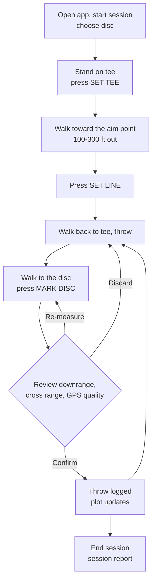

# Disc Golf Throw Tracker — Concept of Operations and Requirements

> **Status:** draft 8, 2026-10-30. Collected from the developer's description of the app; updated with the developer's
> answers and field feedback (Section 9). Milestones 1-3 done; milestone 4 (discs and history) mostly built.
> Open questions are listed in Section 9; values marked *(default)* are proposals the developer can change.

## 1. Purpose and scope

A minimalist phone app for measuring disc golf throws (mainly drives) in field practice. The player sets a
throwing point and a target line, throws, walks to the disc, and logs where it landed. The app computes how far
the disc went down the target line (**downrange**) and how far it ended up left or right of it (**cross range**),
and keeps every throw so the player can track distance and accuracy over time, per disc.

In scope: field-work sessions with one player, one tee, and one target line per session; GPS positioning;
on-device storage; reports; a plain throw plot. A satellite map under the plot is planned for version 2
(Section 4.8).

Out of scope for the first version: course play and scoring, multiple players, cloud accounts or sync, flight
path tracking, wind or elevation measurement, smartwatch support. Saving a field's tee and line for reuse in a
later session is also out of scope by decision: every session sets its own tee and line (Section 9).

**Conventions.** Requirements use "shall" and carry an ID of the form `DGT-<area>-<nnn>`. Verification methods
are Test (T), Inspection (I), and Demonstration (D, done in the field with the real phone).

## 2. Concept of operations

### 2.1 Field workflow



1. **Start session.** The player opens the app, picks the disc being thrown (Section 4.5), and starts a session.
2. **Set tee.** Standing at the throwing position, the player presses **Set Tee**. The app records the tee position.
3. **Set line.** The player walks in the direction they intend to throw (the ideal centre line) to any
   comfortable distance and taps **Set Line**. That one tap is all it takes: the app records the aim point, and the
   tee and aim point together define the centre line. Only the direction matters, not the distance walked — but a longer walk gives a more
   accurate direction (Section 6).
4. **Throw and mark.** The player walks back to the tee and throws. At the disc they press **Mark Disc**. The app
   records the disc position and shows the downrange distance in large type, with the cross range and GPS quality
   beneath it (Section 4.3.1).
5. **Confirm.** If the numbers look right the player taps **Confirm**, directly below the distance, and the throw
   is logged with a timestamp. They can instead re-measure or discard it.
6. **Repeat** steps 4–5 for as many throws as they like. The plot of the tee, the centre line, and this
   session's throws updates after each confirmed throw.
7. **End session.** The app shows the session report (Section 4.9). The session is saved automatically.

### 2.2 Users

A single player using their own phone, outdoors, often in bright sun, sometimes with one hand full (discs, bag).
The field may have no mobile data signal.

## 3. Definitions

| Term | Meaning |
| --- | --- |
| Tee (T) | The recorded throwing position for a session. |
| Aim point (A) | The recorded point the player walked to in order to define the centre line. |
| Centre line | The ray from T through A. Its direction is the unit vector **u** = (A − T) / \|A − T\|. |
| Baseline | The distance \|A − T\| between tee and aim point. |
| Disc position (D) | The recorded landing/resting position of the disc for one throw. |
| Downrange | The distance from the tee along the centre line to the disc: **d** · **u**, where **d** = D − T. Negative if the disc is behind the tee. |
| Cross range | The signed perpendicular distance from the centre line to the disc. **Positive = right** of the line as seen from the tee looking downfield; negative = left. |
| Total distance | The straight-line distance from tee to disc, \|**d**\|. This is what disc golfers usually call "distance". |
| Fix | One position report from the phone's location service, with its reported horizontal accuracy. |
| Mark | A position the app computes from several fixes taken while the player stands still (Section 4.2). Tee, aim point, and disc positions are all marks. |
| Session | One tee, one centre line, one disc, and the throws made from them. |

## 4. Functional requirements

### 4.1 Sessions

| ID | Requirement | Ver. |
| --- | --- | --- |
| DGT-SES-001 | The app shall let the player start a new session and shall require a disc to be chosen before the first throw is marked. | T |
| DGT-SES-002 | A session shall record its start time, end time, disc, tee mark, aim-point mark, and an optional free-text note (e.g. field name, wind). | T |
| DGT-SES-003 | The app shall save the session and every confirmed throw to device storage as soon as it is created or confirmed, so that nothing is lost if the app is closed, killed, or the phone restarts. | T |
| DGT-SES-004 | On reopening, the app shall offer to resume an unfinished session. | T |
| DGT-SES-005 | The player shall be able to re-set the tee and centre line during a session (e.g. after moving to a new tee). Doing so shall start a new session that carries over the disc. | T |
| DGT-SES-006 | The player shall be able to end a session, view any past session, rename or annotate it, and delete it (with a confirmation step). *Built: view and delete from the disc history (✕ or long press), with its throws; rename and annotate not yet.* | T |

### 4.2 Position marking

| ID | Requirement | Ver. |
| --- | --- | --- |
| DGT-POS-001 | Set Tee, Set Line, and Mark Disc shall each be a single tap of a large on-screen button, with no further confirmation step for Set Tee or Set Line. The averaging in DGT-POS-002 starts on the tap and needs no further input. | I |
| DGT-POS-002 | When a mark is requested, the app shall collect fixes for a short settling window *(default 5 s, configurable 2–15 s)*, extending it until at least 3 fixes have arrived (at most 15 s); discard fixes without satellite lock (DGT-GPS-002) when locked ones are available; and report the mark as the accuracy-weighted average of the remaining fixes, together with their **jitter** (RMS scatter about the average). | T |
| DGT-POS-003 | While a mark is being taken, the app shall show a countdown or progress indicator, the live accuracy, and a prompt to stand still. | D |
| DGT-POS-004 | Each mark shall store latitude, longitude, the combined accuracy estimate, the number of fixes used, and the time. Raw latitude/longitude are kept so that all distances can be recomputed later (e.g. after a formula change). | T |
| DGT-POS-005 | Distances shall be horizontal only; altitude is recorded if available but not used. | T |

### 4.3 Throw measurement and logging

| ID | Requirement | Ver. |
| --- | --- | --- |
| DGT-THR-001 | After Mark Disc the app shall show downrange, cross range (with an L/R indication), total distance, and the GPS quality of the disc mark, before the throw is logged, laid out as in Section 4.3.1. | T |
| DGT-THR-002 | The player shall be able to **Confirm** (log the throw), **Re-measure** (take a new disc mark), or **Discard** the measurement. | T |
| DGT-THR-003 | A confirmed throw shall store its timestamp, its disc mark, the computed downrange, cross range, and total distance, a sequence number within the session, and a flag if any of its marks was taken with a GPS warning active. | T |
| DGT-THR-004 | The player shall be able to delete or annotate a logged throw after the fact (e.g. "rolled", "hit tree"). Deleted throws are excluded from statistics. | T |
| DGT-THR-005 | Downrange and cross range shall be computed in a local flat (east-north) plane centred on the tee, using a WGS-84 local tangent-plane or equirectangular projection. Over the distances involved (< 1 km) the projection error shall be below 0.1 ft. | T |
| DGT-THR-006 | The app shall reject Set Line if the aim point is closer than 30 ft to the tee, and shall warn (but allow) if the baseline is under 300 ft *(default; was 150 ft until field tests, 2026-10-30)* because the line's direction will be imprecise (Section 6). | T |
| DGT-THR-007 | On the review screen the downrange distance shall be the dominant element: the largest text on the screen *(at least 25% of screen height)*, with its unit. Cross range, total distance, and GPS quality shall appear smaller beneath it. | D |
| DGT-THR-008 | The **Confirm** button shall sit directly below the distance, be the largest button on the review screen, and confirm with a single tap. Re-measure and Discard shall be smaller and placed away from Confirm, so they are not hit by accident. | D |
| DGT-THR-009 | ~~Backhand / forehand tag on every throw.~~ *Removed 2026-10-30: the developer has no use for it.* | — |
| DGT-THR-010 | ~~Changing a logged throw's type.~~ *Removed 2026-10-30: the developer has no use for it.* | — |

#### 4.3.1 Review screen layout

```text
┌──────────────────────────────┐
│  GPS ● good  ±2 m            │
│                              │
│            87 m              │  ← downrange, largest text on screen
│          downrange           │
│                              │
│   4 m right · total 87 m     │
│                              │
│  ┌────────────────────────┐  │
│  │        CONFIRM         │  │  ← one tap logs the throw
│  └────────────────────────┘  │
│                              │
│  Re-measure        Discard   │  ← small, away from Confirm
└──────────────────────────────┘
```

If the disc mark has a GPS warning (DGT-GPS-004), the warning appears between the distance and Confirm, and
Confirm reads "Confirm anyway".

### 4.4 GPS quality and warnings

| ID | Requirement | Ver. |
| --- | --- | --- |
| DGT-GPS-001 | The app shall request the phone's highest-accuracy location mode while it is open, and shall show a persistent GPS indicator (OK / no satellite lock / no fix). The phone's reported accuracy shall **not** be shown (developer's decision 2026-10-30: it is absolute, so it says nothing about measurement quality). | D |
| DGT-GPS-002 | Only **relative** accuracy matters (decided 2026-10-30): a steady offset shared by the tee, aim point and disc cancels out. The app shall therefore **not** warn on the phone's reported accuracy, which includes that offset, except when it is worse than **15 m**, which means no satellite lock (Wi-Fi or cell positioning, neither small nor steady). | T |
| DGT-GPS-003 | The app shall warn when no fix has been received for more than 5 s, when location permission is denied or limited to approximate location, and when the fix is stale (older than 5 s). | T |
| DGT-GPS-004 | A mark is **unsteady** if its jitter exceeds **10 ft (3.05 m)** *(default, configurable)*; **unchecked** if fewer than 3 fixes arrived; or **no lock** (DGT-GPS-002). For a non-steady disc mark the review screen shall say so and let the player re-measure or accept it anyway; for a tee or aim mark the app shall say so and offer to set it again. Accepted non-steady disc marks are flagged (DGT-THR-003) and can be excluded from statistics with a filter. | T |
| DGT-GPS-005 | The app shall show the estimated uncertainty of the centre line's direction after Set Line (in degrees, and as the resulting cross-range uncertainty at 100 m / 300 ft), computed from the tee and aim marks' jitter, so the player can decide to re-walk it. | T |
| DGT-GPS-006 | **Tee check.** While throwing, the player shall be able to re-mark the tee while standing on it. The app shall show how far that is from the stored tee: the drift of the GPS offset since the tee was set, which is the error drift adds to every measurement. Above 10 ft *(default)* it shall suggest setting a new tee and line. | T |
| DGT-GPS-007 | **GPS test.** From the settings screen, the player shall be able to record GPS while standing on one spot (2, 5 or 10 min). The app shall then simulate a mark every 30 s with 5, 15 and 30 s holds and show, for each, the typical error (RMS about the marks' centre) and the worst swing between two marks; the drift from the first to the last 30 s; whether a longer hold helps; and a scatter of every reading and the 5 s marks. | T |

### 4.5 Discs

| ID | Requirement | Ver. |
| --- | --- | --- |
| DGT-DSC-001 | The app shall keep a list of the player's discs. Each disc has a name (e.g. "Leopard DX") and optionally manufacturer, plastic, weight, colour, and flight numbers (speed / glide / turn / fade, e.g. 6 / 5 / −2 / 1). | T |
| DGT-DSC-002 | The player shall be able to add discs (by typing a new name) and delete them: a long press on a disc on the start screen, confirmed in a dialog that says how many sessions and throws go with it. Deleting a disc deletes its sessions and throws. | T |
| DGT-DSC-003 | Each session shall be tagged with exactly one disc. Statistics and plots shall be filterable by disc. (A disc *type* was dropped 2026-10-30: no use to the developer.) | T |

### 4.6 Units and display

| ID | Requirement | Ver. |
| --- | --- | --- |
| DGT-UNI-001 | The player shall be able to choose feet or meters in settings *(default meters)*. The choice applies to every display and report and can be changed at any time without altering stored data. | T |
| DGT-UNI-002 | Positions and distances shall be stored internally in SI units (degrees, meters) at full precision. | I |
| DGT-UNI-003 | Distances shall be displayed to the nearest **1 ft**, or the nearest **1 m** in metric. (This is display resolution; Section 6 explains the actual accuracy.) | T |

### 4.7 Plot

| ID | Requirement | Ver. |
| --- | --- | --- |
| DGT-PLT-001 | The app shall show a plot (the *plain plot*: simple shapes on a plain background) in throw coordinates: tee at the bottom centre, centre line pointing straight up, cross range horizontal (right = right of line), with distance grid lines *(default every 50 ft / 10 m)*. | D |
| DGT-PLT-002 | The plot shall show the current session's throws as dots, and shall be visible on the main session screen or reachable from it in one tap after each confirmed throw. | D |
| DGT-PLT-003 | The player shall be able to overlay throws from previous sessions, drawn in a different, less prominent colour. The plot shall offer **This Session** (only the current session's throws) and **All Sessions** (also every earlier session with the same disc), remembered between sessions; later, a date range. | D |
| DGT-PLT-004 | Because every session has its own tee and line, previous sessions shall be overlaid in their own throw coordinates (downrange, cross range), not by map position. This makes throws from different days and fields directly comparable. | T |
| DGT-PLT-005 | Tapping a dot shall show that throw's details (distances, time, session, disc, note). | D |
| DGT-PLT-007 | ~~Different markers for backhand and forehand.~~ *Removed 2026-10-30: the developer has no use for it.* | — |
| DGT-PLT-008 | This session's throws shall be drawn as dots with the throw number inside, coloured by throw number on one blue ramp from light (first) to dark (latest); the throw list shows matching numbered badges. Earlier sessions' throws stay small and grey. | D |
| DGT-PLT-006 | The plot shall auto-scale to fit the shown throws, at the same scale both ways, and support pinch zoom *(pinch zoom not built yet)*. | D |

### 4.8 Satellite map (version 2)

> **Deferred to version 2** by the developer (2026-10-30), to avoid setting up a Google Maps API key for version 1.
> Version 1 shows only the plain plot. The requirements below are kept so version 2 can pick them up as written.

| ID | Requirement | Ver. |
| --- | --- | --- |
| DGT-MAP-001 | When a network connection is available, the plot shall be drawn over satellite imagery of the field, rotated so the centre line points straight up with the tee at the bottom, matching the plain plot's orientation (DGT-PLT-001). | D |
| DGT-MAP-002 | On the map, the tee, aim point, centre line, and the current session's throws shall be drawn at their measured positions. | D |
| DGT-MAP-003 | Previous-session throws overlaid on the map (DGT-PLT-003) shall be placed by their downrange and cross range relative to the *current* tee and line, not at their original locations, and the legend shall say so. | T |
| DGT-MAP-004 | If there is no network connection, or the imagery has not loaded within 5 s *(default)*, the app shall show the plain plot instead, without an error dialog. A small indicator shall say the map is unavailable. When the connection returns, the map may come back the next time the plot is opened; it shall not swap views while the player is looking at it. | T |
| DGT-MAP-005 | The player shall be able to choose the plain plot even when the map is available (a Map / Plain toggle on the plot, plus a setting for the default). | D |
| DGT-MAP-006 | Imagery the map library has already cached may be shown offline; the fallback applies only when the needed imagery is missing. | D |
| DGT-MAP-007 | Markers and lines on the map shall have dark outlines or halos so they stay visible on imagery in bright sun. | D |
| DGT-MAP-008 | Viewing a past session with a connection shall show that session on the map at its own field. | D |
| DGT-MAP-009 | The map service's API key shall be supplied at build time and shall not be committed to the repository. | I |

### 4.9 Reports and progress

| ID | Requirement | Ver. |
| --- | --- | --- |
| DGT-RPT-001 | The session report shall list every throw (sequence, time, downrange, cross range, total distance, flags, note) and the session's plot. | T |
| DGT-RPT-002 | The session report shall give, over confirmed throws: count; downrange max, mean, median, and standard deviation; cross range mean (left/right bias), standard deviation, and mean absolute value; and the percentage of throws within a configurable corridor of the line *(default ±20 ft)*. | T |
| DGT-RPT-003 | A disc history, opened from the start screen for the selected disc, shall show all-time longest, average and average miss, every throw on the plot, and the disc's sessions (date, throws, best, average), each opening its session report *(built)*. A chart of session statistics over time is still to come. | D |
| DGT-RPT-004 | The app shall export a session, or all data, as CSV (one row per throw) and as JSON (full data including raw marks), through the phone's share sheet. | T |
| DGT-RPT-005 | The app shall import a JSON export, so data survives a phone change or reinstall. | T |

## 5. Non-functional requirements

| ID | Requirement | Ver. |
| --- | --- | --- |
| DGT-NFR-001 | **Offline.** All functions shall work with no network connection. (From version 2, satellite imagery is the exception; it falls back to the plain plot, DGT-MAP-004.) | D |
| DGT-NFR-002 | **Minimal UI.** The session screen shall show one primary action at a time (the next step in the workflow), with buttons large enough to hit with a thumb while walking. Nothing tappable shall sit under Android's status bar or navigation buttons (the app is drawn edge to edge). | I |
| DGT-NFR-003 | **Sunlight.** The session screen shall be readable in direct sun: high contrast, large type for the key numbers. A dark theme is optional. | D |
| DGT-NFR-004 | **Screen awake.** The screen shall stay on while a session is active *(default on, configurable)*. | D |
| DGT-NFR-005 | **Battery.** High-accuracy location shall run only while the app is open in the foreground (it also runs on the start screen, so GPS has settled before Set Tee); the app shall not track location in the background. | I |
| DGT-NFR-006 | **Privacy.** Data stays on the device unless the player exports it. No account, no analytics. Version 1 makes no network requests. (From version 2, map imagery requests reveal the area being viewed to the map provider; choosing the plain plot as default, DGT-MAP-005, avoids them.) | I |
| DGT-NFR-007 | **Platform.** The app shall run on a current Android phone *(proposed minimum Android 10)*. iPhone is not a target; the framework choice keeps it possible later (Section 7). | D |
| DGT-NFR-008 | **Testability.** The geometry and statistics code shall be pure functions with unit tests, and the app shall support a simulated-location mode so the full workflow can be exercised without walking a field. | T |

## 6. GPS accuracy: what to expect

This section is here so the requirements' numbers make sense and the results are read correctly.

**Phone GPS is good to about 3–5 m (10–16 ft) absolute in open sky,** and many phones never report better than
±3 m (the developer's phone does not). The reported accuracy is an estimate of *absolute* error (on Android, a
68% radius), and most of that error is an offset that changes slowly. For this app only *relative* error matters:
an offset that stays the same while the tee, aim point and disc are marked cancels out of every distance. So the
app ignores reported accuracy (DGT-GPS-002) and watches the two things that do spoil measurements:

- **Jitter** (DGT-GPS-004): how much the fixes scatter while the player stands still for a mark.
- **Drift** (DGT-GPS-006): how much the offset changes over a session. It is invisible within one mark but shows
  up when the tee is re-marked later.

**Field result (2026-10-30): jitter badly understates the real error.** Marks taken on the same spot a minute or so
apart differed by up to 10 ft, while the jitter within each 5 s window was small. Phone GPS error mostly wanders
slowly (over tens of seconds to minutes), and Android smooths its output, so the readings in a 5 s window are nearly
copies of each other: averaging them removes little and their scatter says little. The jitter warning
(DGT-GPS-004) therefore only catches gross problems; the real mark-to-mark error is what the GPS test (DGT-GPS-007)
measures, and it applies to every throw because the tee and disc are marked minutes apart.

**GPS test result (developer's phone, 2026-10-30):** about 1 ft typical error between marks on one spot, much
better than the earlier 10 ft swings. The developer may mark by laying the phone on the disc, which removes
hand-position differences; if that works out it becomes an in-app tip.

**Averaging helps, but only partly.** Averaging fixes over a few seconds (DGT-POS-002) removes jitter, but not slow
errors such as signal reflections. That is why the app averages but still reports quality honestly.

**Errors near in time and space are correlated.** The tee, aim point, and disc are measured within minutes and a
few hundred feet of each other, so much of their error is shared and cancels in the differences the app computes.
The figures below assume independent 3 m errors, the worst case with no shared offset, and are therefore pessimistic.

**Downrange** combines the tee and disc errors: roughly ±14 ft (one sigma) at worst, often much better. "To the
foot" is the display resolution, not the accuracy.

**Cross range depends on the baseline — so the distance walked to set the line does matter.** The direction of the
centre line is uncertain by about √2 × 3 m ÷ baseline:

| Baseline (tee → aim point) | Line direction uncertainty | Cross-range error from the line alone, at a 300 ft throw |
| --- | --- | --- |
| 100 ft (30 m) | ≈ 8° | ≈ 42 ft |
| 200 ft (61 m) | ≈ 4° | ≈ 21 ft |
| 300 ft (91 m) | ≈ 2.7° | ≈ 14 ft |

So the app warns on short baselines (DGT-THR-006) and shows the line's uncertainty (DGT-GPS-005). Walking 500 ft
(150 m) or more is recommended.

**Field result (2026-10-30): make the line longer than the throws.** With a 250 ft line, cross range showed a 5-11 ft
rightward bias; with a 600 ft line it was spot on. A sideways error *e* in the aim point tilts the line, moving a
throw of length *D* sideways by *e* × *D* / *L* for a line of length *L*. A line longer than the throws therefore
shrinks the aim-point error (to about 40% for a 250 ft throw on a 600 ft line), while a line shorter than the
throws magnifies it. The disc mark's own error (drift between setting the tee and marking the disc) is not
reduced; re-zeroing at the tee before each throw would address that if it proves necessary. Note that a test with
the disc placed on the aim point is not sensitive to line length: there, cross range is only the aim point's GPS
drift between its two marks.

**Within a session, the tee and line errors are the same for every throw.** They shift or rotate the whole group
of throws together, so the *spread* of a session's throws (consistency) is more trustworthy than its absolute
left/right *bias*. Comparing bias across sessions should be done with that in mind.

## 7. Recommended framework

**Recommendation: React Native with Expo, in TypeScript.**

| Need | Expo answer |
| --- | --- |
| Android now, iPhone possible later | React Native compiles to a native Android app; the same code builds for iPhone if that is ever wanted. |
| GPS with reported accuracy | `expo-location`: highest-accuracy mode, continuous position watch, horizontal accuracy on every fix. |
| On-device storage | `expo-sqlite` (sessions, throws, discs as tables; easy queries for the progress view). |
| Plot | `react-native-svg` (simple and sufficient), or `@shopify/react-native-skia` if it ever needs to be fancier. |
| Satellite map (version 2) | `react-native-maps`, which uses the Google Maps SDK on Android: satellite imagery, camera rotation (so the line points up), markers and lines in latitude/longitude, and its own tile cache. `expo-network` reports whether a connection is available. |
| Screen awake, export | `expo-keep-awake`, `expo-file-system` + `expo-sharing`. |
| Try it on your own phone fast | Expo Go or a development build: scan a QR code and the app runs on the phone, reloading as you edit. |
| Language | TypeScript — the same language as the CSDS Visualizer. |

On Android, `expo-location` uses Google's fused location provider, the same one a native app would use. The
finished app is an APK installed directly on the phone (side-loaded); no Play Store listing or developer account is
needed. GitHub Actions builds it on every push and attaches it to a GitHub release (decided 2026-10-30; see the
README).

For version 2, the map needs a Google Maps API key from a Google Cloud project, which requires a billing account to be set up.
Map loads in the Android Maps SDK have so far been free of charge, which would make one person's use cost nothing,
but check Google's current pricing before relying on it. Alternatives with similar imagery are Mapbox and Esri;
both also need an account and key.

**Alternatives considered:**

- **Native Android (Kotlin with Jetpack Compose).** Now that the target is Android only, this is the strongest
  alternative: direct access to the fused location provider and raw GNSS measurements, and no framework layer.
  It loses the fast phone-reload loop of Expo Go, needs Android Studio, and means a new language. Worth choosing
  if raw-GNSS work (e.g. dual-frequency processing) ever becomes a goal; not needed for the requirements here.
- **Flutter (Dart).** Technically as good a fit as Expo; the deciding factor is that Dart is a new language and
  TypeScript is already in use.
- **Progressive web app (browser).** Fastest to start, nothing to install, and the browser Geolocation API reports
  accuracy. But the browser can clear a web app's stored data, location control is coarser, and it feels less like an
  app in the field. Reasonable for a throwaway prototype, not for the real thing given that saved history is a
  core feature.
- **Compass instead of walking the line.** Rejected: phone compasses are often off by 5–10° or more near metal,
  worse than a 200 ft walked baseline.

## 8. Data model (sketch)

```text
Disc     { id, name, manufacturer?, plastic?, weight_g?, colour?, speed?, glide?, turn?, fade?, retired }
Mark     { lat, lon, accuracy_m, spread_m, fix_count, time, altitude_m? }   // spread_m: the mark's jitter
Session  { id, disc_id, started_at, ended_at?, tee: Mark, aim: Mark, note? }
Throw    { id, session_id, seq, time, disc: Mark,
           downrange_m, crossrange_m, total_m, low_quality: bool, deleted: bool, note? }
Settings { units: ft|m, gps_warn_threshold_m, settle_seconds, keep_awake, corridor_m, short_baseline_m,
           plot_default: map|plain, map_timeout_s }   // plot_default and map_timeout_s from version 2
```

Computed distances are stored for convenience but can always be recomputed from the marks (DGT-POS-004).

## 9. Decisions and open questions

**Decided (2026-10-30):**

- **Platform:** Android only (DGT-NFR-007).
- **Disc:** one disc per session (DGT-DSC-003). Switching discs means starting a new session.
- **Metric resolution:** nearest meter (DGT-UNI-003).
- **Setting the line:** a single tap of Set Line at the aim point, with no confirmation step (DGT-POS-001).
- **Review screen:** downrange in large type with Confirm directly below it (DGT-THR-007, DGT-THR-008, Section 4.3.1).
- **No throw type or disc type** (field feedback): backhand/forehand and distance/fairway/mid/putter were dropped;
  neither adds value for the developer (DGT-THR-009, -010, DGT-PLT-007 removed; DGT-DSC-001, -003 changed).
- **US spelling:** "meters", not "metres".
- **Phone-on-the-disc tip** on the Mark Disc step and in its hold-still overlay (field habit, about 1 ft error).
- **Units and the GPS test in a settings screen** (three-lines menu on the start screen), since both are rarely
  used (DGT-UNI-001, DGT-GPS-007).
- **GPS test mode** (DGT-GPS-007), after field marks on one spot swung by up to 10 ft: measure before deciding
  whether a longer hold is worth it.
- **Reported GPS accuracy hidden** (DGT-GPS-001); the plot's choice is This Session / All Sessions (DGT-PLT-003);
  throws are numbered and colour-coded by throw number (DGT-PLT-008).
- **Cross-range sign:** right of the line, looking downfield from the tee, is positive (Section 3).
- **No saved tees:** every session sets its own tee and line; fields are not remembered (Section 1).
- **Satellite map in version 2,** falling back to the plain plot when there is no connection (Section 4.8).
  Deferred from version 1 so no API key is needed yet.
- **Default unit:** meters, feet selectable (DGT-UNI-001).
- **Map provider (version 2):** Google Maps through `react-native-maps`.
- **Relative accuracy only:** a steady GPS offset is fine; warnings come from jitter and tee drift, not the phone's
  reported accuracy (DGT-GPS-002, -004, -006). Prompted by the developer's phone never reporting better than ±3 m.

No questions are open.

## 10. Suggested milestones

1. **Geometry core.** Pure TypeScript functions for projection, downrange, cross range, line uncertainty, and
   statistics, with unit tests (DGT-THR-005, DGT-RPT-002, DGT-GPS-005).
2. **Field prototype.** One screen: Set Tee, Set Line, Mark Disc, Confirm, with the GPS indicator and warnings,
   saving to SQLite. Take it to a field and check against a tape measure or known distances. *Built 2026-10-30:
   also includes the disc and unit choice, resume, the tee check, throw deletion, and a basic session report.*
3. **Plot and session report.** *Built 2026-10-30: plot on the throwing screen and in the report, earlier throws
   overlaid (off / this disc / all), tap a dot for details. Not yet: pinch zoom, date filter.*
4. **Discs, history, and the previous-sessions overlay.** *Built 2026-10-30: disc history from the start screen,
   long-press delete, All Sessions overlay. Not yet: the chart over time (DGT-RPT-003).*
5. **Progress view, export and import, settings polish.**

Version 2: the satellite map (Section 4.8).
